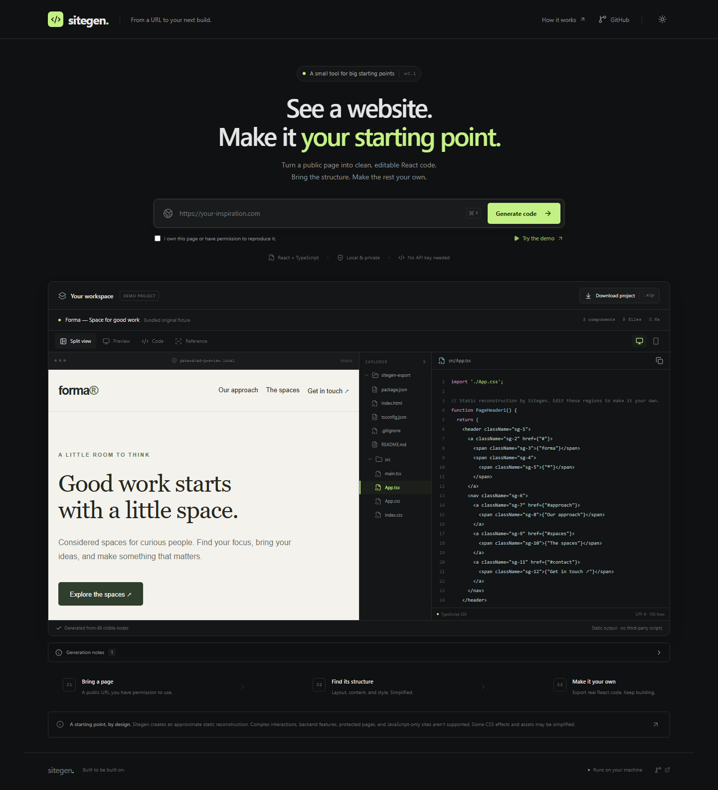

# Sitegen

**A website URL. An editable React starting point.**

Sitegen is a local developer tool that inspects a public web page and creates an approximate, static React reconstruction. Compare the reference screenshot with the generated preview, explore the actual files, and download a runnable project. No AI API key, account, database, or paid service is required.

Use it only for pages you own or have permission to reproduce. This is a starting point for development; it does not guarantee a complete or pixel-perfect reproduction.



## Features

- HTTP/HTTPS input with validation, permission confirmation, keyboard submission, and useful errors.
- Sandboxed Chromium rendering with page scripts disabled and a fresh browser context for each inspection.
- Extraction of visible content, navigation, images, layout, typography, colors, and spacing into a bounded intermediate representation.
- Deterministic React components and CSS, with basic responsive approximations.
- A script-free generated preview, desktop/mobile sizing, and an original-page screenshot when available.
- File explorer, syntax highlighting, line numbers, copy feedback, and a ZIP download.
- An original, bundled Forma demo that runs through the same rendering, extraction, and generation pipeline without internet access.
- Responsive dark and light themes, keyboard controls, and reduced-motion support.

## Stack and structure

React, TypeScript, Vite, Tailwind CSS, and Lucide power the frontend. Node.js, Express, and Playwright power the local API. Vitest, React Testing Library, Supertest, and Chromium check the complete workflow.

```text
src/                 React interface, preview, code viewer, and UI tests
server/
  security.ts        Public-URL validation and DNS-pinned resource transport
  browser-network.ts Deny-all proxy for direct browser network traffic
  inspect.ts         Sandboxed rendering and network interception
  extract.ts         Visible DOM → intermediate page model
  generate.ts        Page model → React, CSS, safe preview, and ZIP
  demo.ts            Original offline HTML fixture
  app.ts             Local API, validation, concurrency, and download cache
  index.ts           Loopback server and production static serving
shared/types.ts      Intermediate model and API types
tests/               Backend, security, generation, and browser fixture tests
scripts/             Full browser, independent export, and public URL checks
docs/screenshots/    Screenshots captured from the working application
```

## Installation

Use Node.js **22.12+** (Node 24 LTS recommended) and npm.

```sh
git clone https://github.com/pulkitdotio/sitegen.git
cd sitegen
npm ci
npx playwright install chromium
npm run dev
```

Open **http://127.0.0.1:5173**. Vite runs on port 5173 and proxies `/api` to the backend at **127.0.0.1:3001**. Both services bind to loopback.

On Linux, install Chromium’s system dependencies using `npx playwright install --with-deps chromium` if needed. The OS must support Chromium’s sandbox. Sitegen deliberately fails rather than adding `--no-sandbox` or turning off security controls. Some restricted containers and automation executors cannot launch sandboxed renderer processes; use a normal local terminal with the required OS support. On Windows PowerShell, use `npm.cmd` and `npx.cmd` if execution policy blocks the `.ps1` shims.

Run services separately with `npm run dev:server` and `npm run dev:client`. The backend reads the optional `PORT` process environment variable; `.env.example` documents its default. It does not automatically load `.env` files. If changing the API port, update the development proxy in `vite.config.ts` as well.

For a production build **on your own machine**:

```sh
npm run build
npm start
```

Open **http://127.0.0.1:3001**. This serves the compiled interface and API together. No hosting deployment is provided or implied.

## Try it

1. Click **Try the demo**. This renders the bundled original Forma page in Chromium; it is not a hardcoded code-viewer example.
2. Or enter a small public HTML page, confirm reproduction permission, and click **Generate code**. Only that page is inspected; links are never crawled.
3. Switch between **Split view**, **Preview**, **Code**, and **Reference**. Select files in the explorer or the compact file selector. The preview displays generated output, never the live source site.
4. Copy a file, or download the complete ZIP. Downloads expire after ten minutes; regenerate if an export has expired or the backend restarted.

`Ctrl/Cmd + K` focuses the URL input. Help explains the workflow; the theme preference stays in your browser’s local storage. The app does not keep a project history.

## Export and edit

Unzip `sitegen-export.zip`, open `sitegen-export` in VS Code, then run:

```sh
npm install
npm run dev
npm run build
```

The export includes `package.json`, `index.html`, `tsconfig.json`, `.gitignore`, `src/main.tsx`, `src/App.tsx`, `src/App.css`, `src/index.css`, and a source-specific `README.md`. It is an independent Vite + React + TypeScript project. Edit the region components and their numbered CSS rules; no connection to Sitegen is required after export.

## How generation works

1. Validate the URL and resolve its hostname. Reject any non-public DNS answer.
2. Fetch the document through a bounded Node transport. The socket connects to the validated IP while preserving the original HTTP Host and HTTPS certificate identity. Follow and revalidate redirects manually.
3. Launch sandboxed Chromium behind an ephemeral deny-all loopback proxy, with direct DNS resolution disabled, and create an isolated context without JavaScript, service workers, downloads, or permissions. Fulfill every permitted stylesheet/image/font request through the same safe transport. The proxy never forwards requests or CONNECT tunnels; speculative browser connections are denied too. Never let Chromium follow an HTTP redirect or fetch an unvalidated resource directly.
4. Read visible elements and a fixed set of computed style properties. Cap node count, depth, text, and scanning. Keep structural regions, useful text, links, and scalar styles; omit scripts, embeds, tracking, metadata, and form fields.
5. Generate named React region components, CSS, and a static HTML rendering from that same intermediate model. Text and attributes are escaped for their output context. The original site’s HTML, stylesheet source, and JavaScript are not dumped into the project.
6. Build a ZIP from fixed generated filenames. Up to three results stay in bounded process memory. Download expiry is checked and expired entries are pruned on the next API access; nothing is persisted to disk.

Small loaded PNG/JPEG/WebP/GIF images are embedded in the output. Missing images, SVG/AVIF images, images over 256 KB, and unsupported assets become placeholders. Remote fonts are not copied; font-family names rely on installed fonts and browser fallbacks. Exported projects and previews load no remote image or font assets. Safe HTTP/HTTPS links remain external links in the export; preview links are inert. Section fragment links and safe identifiers are retained. Generated buttons are disabled visual elements.

## Security and operating limits

This MVP is intended for **local use only**. Do not expose the URL-processing API publicly without an independent security review, OS-level network containment, abuse controls, and additional hardening. Browser sandboxing and application-level interception are defense layers, not a guarantee against browser vulnerabilities.

The API binds to `127.0.0.1`, checks Host/Origin and cross-site request metadata, and requires JSON. It accepts no supplied cookies, headers, credentials, or browser profile. URL user information and common credential-like query parameters are rejected. Set-Cookie and other source response headers are never forwarded; all resource fetches use clean fixed headers. Do not enter secrets or signed/authenticated URLs, including unusual credential parameter formats the validator cannot identify.

Private, loopback, link-local, multicast, reserved, cloud metadata, IPv4-mapped IPv6, and special-use addresses are blocked. All DNS answers must be public. Each connection uses its validated IP, so a second DNS resolution cannot rebind that connection. Redirects and subresources are revalidated. Only standard web ports 80/443 are allowed. WebSockets, frames, scripts, automatic secondary navigations, downloads, forms, and non-GET browser requests are blocked. TLS certificate errors are never ignored. Source content is data, never instructions.

The generated iframe uses an empty `sandbox`, no referrer, and a CSP that denies scripts, connections, frames, objects, forms, and remote assets. No `eval`, third-party scripts, or runtime JSX compilation is used in previews.

| Limit                                | Default                                          |
| ------------------------------------ | ------------------------------------------------ |
| Concurrent inspections               | 1; additional requests return 429                |
| Total inspection deadline            | 25 seconds, including browser cleanup initiation |
| Browser launch / navigation          | 8 / 15 seconds                                   |
| DNS / individual HTTP request        | 3 / 6 seconds                                    |
| Redirects per resource               | 5                                                |
| Total network requests               | 70, including redirects                          |
| Per resource / total response bodies | 2 MiB / 12 MiB                                   |
| Extracted nodes / depth              | 350 / 12                                         |
| Scanned elements / extracted text    | 6,000 / 50,000 characters                        |
| Reference screenshot                 | 1280 × 900, one viewport                         |
| Embedded raster image                | Less than 256 KiB                                |
| Cached projects / download lifetime  | 3 / 10 minutes                                   |
| API JSON request body                | 4 KiB                                            |

These limits bound application work. They are not an OS process memory quota. The browser, context, and ephemeral network guard close in a `finally` block, and outstanding HTTP requests abort on completion or timeout. Source responses requiring compression despite `Accept-Encoding: identity` fail safely rather than risking unbounded decompression.

## Supported pages and limitations

Small, public, server-rendered HTML pages work best. JavaScript is intentionally disabled during inspection. Client-rendered apps, protected/authenticated pages, browser challenges, PDFs, downloads, nonstandard ports, and websites blocking automated access are unsupported. Authentication checks are conservative heuristics; Sitegen does not authenticate or attempt to bypass restrictions.

Complex interactions, form behavior, backend features, and authentication cannot transfer. CSS effects, absolute positioning, responsive breakpoints, pseudo-elements, icons, and complex layout may be approximated or omitted. Only visible static content is captured; no lazy-load scrolling or multi-page crawling occurs. Large pages may be simplified or rejected. The reference is the script-disabled source page, so it may differ from a normal browsing session.

Review generated code, links, content rights, responsive behavior, and accessibility before further development. Generation failures produce an error, never a fabricated successful result. A previous successful project can remain visible when a later request fails.

## Testing

```sh
npm run lint
npm run typecheck
npm test
npm run build
# Or run all four:
npm run check
```

The test suite covers URL schemes and malformed input, special-use IPs, mixed DNS answers, DNS rebinding, redirects, browser resource restrictions, authentication rejection, local HTML extraction, intermediate models, deterministic generation, hostile text/attributes/CSS, file completeness, ZIP contents, API errors/concurrency, and frontend interactions. Browser fixture tests require installed, sandbox-capable Chromium but no internet.

Additional workflow checks:

```sh
# With npm run dev already running in another terminal:
npm run test:browser
# Generate the offline fixture, install its separate dependencies, and build it:
npm run test:export
# Optional live-network smoke check against example.com:
npm run test:public
# With npm run build already complete:
npm run test:production
```

`test:browser` verifies demo → API → browser extraction → generated files → safe preview → copy → ZIP, plus reference view, mobile sizing, themes, help, validation, unsafe URL rejection, and console errors. `test:export` checks an actual independently installed generated project. Verification output and screenshots are saved under ignored `.verification/`; exported dependency installation and the optional public check need internet access.
